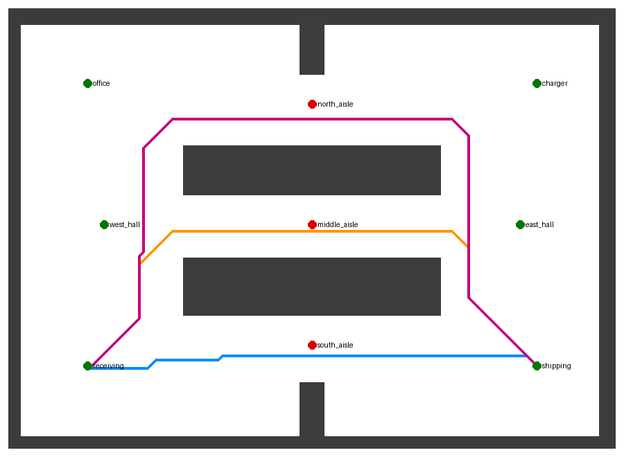

# 言葉で指示し、自律で迂回し、複数台で協調する倉庫搬送ロボット(PAI 最終課題)

Gazebo 上の差動二輪ロボット(LiDAR 搭載)に **日本語で搬送を指示** する。
通路が障害物で塞がれていて進めなくなると、**ロボットが状況を報告し、LLM が別の通路を経由する計画に作り直して** 目的地へ向かう。
手のジェスチャー(MediaPipe)での手動操縦・非常停止にも対応。MacBook Air(Apple Silicon)1 台・追加費用 0 円で動作する。
さらに、同じ狭い通路を使う **2 台の協調** を、協調なし・統制 LLM・通路の拡幅と車線の規則・機体間通信・2 層(通信 + 例外時の統制 LLM)で比較した(下の「複数台(2 台)の協調の検証」)。

**説明動画:** https://youtu.be/U1F-BdaU8DY (録画した場面は全て 8 倍速)



## 何をするか

| 場面 | 処理 |
|---|---|
| 「入荷口の荷物を出荷口へ運んで」 | LLM が地点 id の列に変換 → 経路検証 → Nav2 が自律移動 |
| 南通路にパレットが置かれ進めない | 立ち往生を検出して停止・報告 → 南通路を「通行止め」として記憶 → LLM が中央通路経由の計画を作成 → 経路検証 → 再出発 |
| さらに中央通路も塞がれる | 同様に北通路経由へ。全通路が塞がれたら到着不能を報告 |
| 「南通路が片付いたよ」 | LLM が通行止めを解除。以後は最短の南通路を使う |
| 握りこぶし | 自律移動を非常停止 |

## 工夫した点

1. **再計画の判断を AI 層に置く**
   Nav2 の大域計画は静的地図だけを使う設定にした(一時的な障害物は LiDAR による局所回避のみ)。
   通路単位の判断、つまりどの通路を通るか・どこが塞がっているかは、上位の LLM が受け持つ。
   この構成により、次の 3 つが Nav2 単体ではできず、本構成でできる。
   - 塞がった通路を記憶し、次の指示にも反映する
   - 人からの口頭の情報(「南通路が塞がってる」)を経路選択に反映する
   - 迂回の理由を言葉で説明する
2. **LLM の出力を信用しない検証ループ**
   LLM の計画は 3 段階で扱う。
   - (1) JSON スキーマで出力形式を制約する
   - (2) 地点 id を照合する
   - (3) 静的地図上で各区間の最短経路を計算し、通行止め通路を通らないか検証する
   NG なら理由を添えて LLM に作り直させる(最大 2 回)。それでも通らなければ、経路探索による迂回案に切り替える。
3. **ワールドと地図を同じ定義から生成**
   倉庫は `tools/gen_warehouse.py` の壁定義 1 つから、Gazebo 用 SDF と Nav2 用地図を両方生成する。そのため SLAM なしで両者が必ず一致する。
   3 本の通路の距離に差をつけて設計しているので、どの通路を選んだかが映像で分かる(南 5.5 m < 中央 7.5 m < 北 10.2 m)。

## 構成

```
 Mac (ネイティブ)                                Docker (Ubuntu 22.04 arm64)
 ┌──────────────────────────────┐  WebSocket ┌────────────────────────────────────────────┐
 │ llm_commander.py             │─/ai/plan──▶│ plan_executor ─NavigateToPose─▶ Nav2       │
 │  ├ planner.py  (LLM+検証)    │◀/ai/status─│  └ 立ち往生検出 → blocked 報告     │       │
 │  ├ route_check (経路検証)    │            │                                    ▼       │
 │  └ Ollama (ローカル LLM)     │            │ rosbridge          ros_ign_bridge ⇄ Gazebo  │
 │ gesture_teleop.py            │─/cmd_vel──▶│                    (倉庫ワールド + LiDAR)  │
 │  └ MediaPipe + カメラ        │   :9090    │ RViz / Gazebo GUI ── noVNC :6080           │
 └──────────────────────────────┘            └────────────────────────────────────────────┘
```

## ディレクトリ

```
docker/                          Dockerfile, compose.yaml
ros2_ws/src/ai_nav/              本課題で追加したパッケージ
  launch/sim.launch.py             Gazebo + ブリッジ + rosbridge(world:=warehouse|field)
  launch/ai_nav.launch.py          上記 + Nav2 + plan_executor + RViz
  ai_nav/plan_executor.py          計画を Nav2 に順次送信、立ち往生を検出して報告
  ai_nav/route_check.py            静的地図上の経路検証・迂回案の算出
  ai_nav/plan_logic.py             計画 JSON の検証
  ai_nav/obstacle.py               デモ用: 通路にパレットを置く/撤去する
  tools/gen_warehouse.py           倉庫ワールドと地図の生成
  config/places_*.yaml             地点辞書(倉庫 / 春ロボフィールド)
host/                            Mac 側
  llm_commander.py                 対話・再計画の実行
  planner.py                       LLM 判断と検証ループ
  gesture_teleop.py                ジェスチャー操縦
ros2_ws/src/nav_dev ほか         元リポジトリ(2DRoboPrac_ws)のロボットモデル等
```

## セットアップ(初回)

### 1. Docker 側

Docker Desktop の設定で、メモリを 8GB 以上割り当てる。

```bash
cd docker
docker compose up -d --build        # 初回はビルドに十数分
```

ブラウザで http://localhost:6080 を開き、デスクトップ内のターミナルで次を実行する。

```bash
cd ~/ros2_ws
colcon build --symlink-install
source install/setup.bash
```

### 2. Mac 側

```bash
brew install ollama python@3.11
ollama serve &                       # Ollama.app を起動していれば不要
ollama pull qwen2.5:7b               # 約 4.7GB。重い場合は qwen2.5:3b

cd host
python3.11 -m venv .venv && source .venv/bin/activate
pip install -r requirements.txt
```

## 実行

### 迂回デモ(メイン)

```bash
# Docker ターミナル 1(描画が重い場合は gz_gui:=false)
ros2 launch ai_nav ai_nav.launch.py
# Mac ターミナル 1
python llm_commander.py
```

1. `> 出荷口まで荷物を運んで` と入力すると、南通路経由で出発する
2. 走行中に Docker ターミナル 2 で `ros2 run ai_nav obstacle place south_aisle` を実行し、パレットを置く
3. ロボットがパレット手前で止まり、約 8 秒後に blocked を報告 → 中央通路経由で再出発する
4. (任意)`ros2 run ai_nav obstacle place middle_aisle` を実行すると、北通路経由に切り替わる
5. `ros2 run ai_nav obstacle clear` で撤去し、`> 南通路は片付いたよ` と伝えると通行止めが解除される

### ROS なしで判断だけ確認

```bash
python llm_commander.py --dry-run
> 出荷口まで荷物を運んで
> /block south_aisle          # 南通路での立ち往生を模擬
> /block middle_aisle
> /state
```

### ジェスチャー操縦

```bash
ros2 launch ai_nav sim.launch.py      # Docker
python gesture_teleop.py              # Mac(自律移動中の非常停止のみなら --nav-mode)
```

| ジェスチャー | 動作 |
|---|---|
| パー | 前進。手を左右に寄せると操舵 |
| 指差し | 手のある側へその場旋回 |
| チョキ | 低速で後退 |
| 握りこぶし | 停止 + 自律移動の非常停止 |
| 手が映らない | 停止 |

春ロボ2024フィールドで動かす場合は、launch に `world:=field`、Mac 側に `--world field` を付ける。

## テスト

```bash
cd ros2_ws/src/ai_nav && python -m pytest test   # 計画検証・経路検証(31件)
cd host && python -m pytest tests                # ジェスチャー変換・再計画ループ・検証用ロジック・指差し・荷物搬送・到着時間の予測・しきい値の選択(79件)
```

再計画ループのテストでは、LLM を台本どおりに応答する偽物に置き換えて、次の 5 点を確認している。

- 検証 NG → 作り直し
- 経路探索への切り替え
- 二重封鎖時に北通路を選ぶこと
- 全封鎖時に到着不能を報告すること
- 再計画回数の上限

## 荷物搬送(指差し + 言葉)

「あれを出荷口へ運んで」と言いながら荷物を指すと、ロボットが荷物置き場へ向かい、積載(模擬)して、出荷口へ運ぶ。
倉庫の外のコントロールルーム(見た目のみ)から、Mac のカメラで手の向きを読み、荷物置き場 3 方向に対応づける。
荷物はロボットの上へ移り(Gazebo の箱。衝突なし)、目的地の前に降ろされる。把持・積載の物理は対象外。
手順・校正・確認項目は `docs/荷物搬送_手順.md`。
荷物の運搬中にパレットで南通路が塞がれても、停止を検出して通行止めに登録し、積載したまま中央通路へ迂回して出荷口で降ろす(実機で確認)。

```bash
bash ~/ros2_ws/run_nav.sh cargo:=true       # Docker(noVNC)
python pointing_cam.py                      # Mac: 指差し(カメラ映像に手の骨格を重ねる。骨格だけにするときは --skeleton-only)
python llm_commander.py --cargo             # Mac: 「あれを出荷口へ運んで」
```

## 追加検証(V1〜V7)

通路の言い換え・初見の通行止め・LiDAR の事前確認などを、無人のランナーで測定した。手順と読み方は `docs/検証ランナー_使い方.md`、結果の考察は `docs/検証記録.md`・`docs/検証記録_改良AE.md` と報告書に記載している。

| ID | 内容 | 実行(`host/` で) | 結果の置き場 |
|---|---|---|---|
| V1 | 初見の通行止めでの経験再利用(なし / 完全一致 / 類似) | `./run_llm_suites.sh` | `docs/計測_LLM_V1_*.csv` |
| V4 | 指示文の言い換え(通行止め・解除) | `./run_llm_suites.sh`, `./run_v4x.sh` | `docs/計測_LLM_V4*.csv` |
| V2 | フォールバック(スタブ LLM) | `./run_auto.sh v2` | `docs/auto/v2.csv` |
| V3 | 口頭解除の LiDAR 事前確認 ON/OFF、誤棄却、未確認停止 | `./run_auto.sh v3` | `docs/auto/v3.csv` |
| V5 | 南パレット → 中央迂回 20 回 | `./run_auto.sh v5` | `docs/auto/v5.csv` |
| V7 | LiDAR しきい値・帯幅の感度と、しきい値の自動選択(`threshold_select.py`) | `./run_auto.sh v7` | `docs/auto/v7_summary.md` |
| V8 | 到着時間の予測と実測の比較(障害物なし 10 経路 × 3 回。経路ごとに除いた当てはめ直しで精度を評価) | `./run_auto.sh v8` | `docs/auto/v8_summary.md` |

- `./run_auto.sh` は Docker と Ollama を起動した Mac で実行する(Gazebo はヘッドレスで自動起動・自動復旧)。
- LLM は温度 0 のため、同一シナリオの繰り返しは独立でない。回数は傾向の確認用で、統計的有意性を示すものではない。
- 利用者発話への応答では `blocked_add` / `blocked_clear` を必須とするスキーマ(`strict_schema`)を使う。ロボットの報告への応答は緩いスキーマで、解除を適用しない。

## 複数台(2 台)の協調の検証

2 台は、それぞれ名前空間(`r1`・`r2`)ごとに Nav2・plan_executor・Planner を持ち、1 台版と同じ仕組みで走る(1 台版のコードは変更していない)。台の間の協調を条件として切り替え、11 シナリオ × 各 10 試行で比較した。

| 条件 | 内容 |
|---|---|
| C0 | 協調なし(相手は LiDAR の障害物として見える) |
| C1 | 統制 LLM が台ごとに通る通路を割り当て、検証で差し戻す |
| C2 | 南通路を幅 1.5 m に広げ、車線の規則(左側通行)を加える |
| C3 | 機体間通信。`/fleet/intent` で「使う通路と向き」を出発前に交換し、優先度の低い台が逆向きの通路を避ける(LLM なし) |
| C4 | 2 層。通常は C3、未着の台・停止した台・未解決の競合があるときだけ統制 LLM を呼ぶ |

主な結果(シミュレータ上の計測):

- 全 11 シナリオの両台到着は C0 98/110、C1 109/110、C3 108/110(C2 は 77/80、3 シナリオは対象外)。差が出たのは逆向きの取り合いで、opp・oppj では C0 12/20 に対し C3 19/20。
- 協調に要した時間の中央値は C3 0.1 秒、C1 4〜13 秒。衝突のない場面では C3 は協調なしと同じ時間で走る。
- 通信が届かないと C3 は協調なし並みに戻る(全不達 6/10)。C4 は全不達でも 10/10。
- 単一で効いた規則のうち 2 つが、複数台で失敗の原因になった。停止を通行止めに登録しない規則で 6 件、到着後に目的地で待つ規則で 12 件。

```bash
cd host
./run_multi_auto.sh C0,C1,C3,C2                       # opp(正面すれ違い)を 4 条件
SCEN=same,cross,wait ./run_multi_auto.sh C0,C1,C3,C2  # シナリオを指定
```

- 実行手順は `docs/検証ランナー_使い方.md` の 6 章。multi 用コンテナ(`docker/compose.multi.yaml`、noVNC は http://localhost:6081)を使う。単体構成のコンテナは止めておく。
- 設計と事前の予想は `docs/multi/設計.md`、結果は `docs/multi/結果.md`、失敗の分析は `docs/multi/失敗の分析.md`、生データは `docs/multi/*.csv`。

## 調整項目

| 項目 | 場所 | 既定値 |
|---|---|---|
| 立ち往生と判定する時間・距離 | `plan_executor` パラメータ `stuck_timeout`, `stuck_distance` | 8 s, 0.10 m |
| LLM 作り直し回数 / 再計画回数 | `planner.py` `max_retries`, `max_replans` | 2 / 6 |
| 倉庫の形状 | `tools/gen_warehouse.py` の `BOXES` を編集して再実行 | - |

## トラブルシュート

| 症状 | 対処 |
|---|---|
| Gazebo の画面が黒い・落ちる | `gz_gui:=false` で起動し RViz で確認する。`compose.yaml` の `seccomp:unconfined` を確認する |
| 2 回目の起動で Gazebo が立ち上がらない | `ps aux \| grep ign` で残ったプロセスを `kill -9` する |
| Mac から接続できない | `docker compose ps` で 9090 番が公開されているか確認する |
| パレットを置いても blocked にならない | Nav2 の回復動作(後退)で動き続けている。`stuck_timeout` を短くする |
| 狭い通路で止まる | `nav2_params.yaml` の `inflation_radius` を下げる |

## ライセンス

Apache License 2.0。元リポジトリからの流用部分は `NOTICE` を参照。
